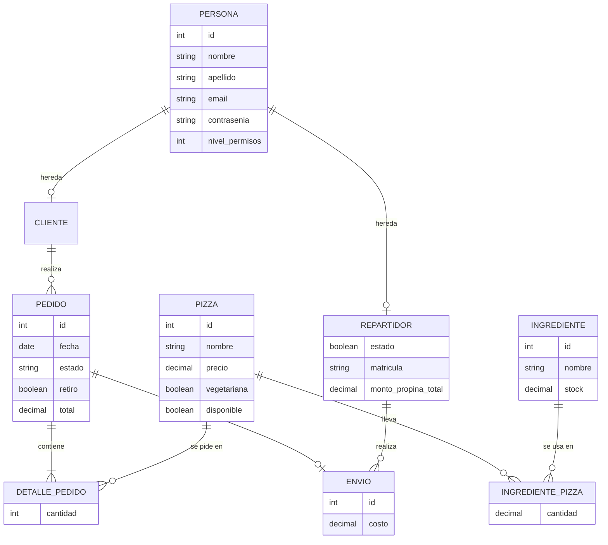

# Propuesta TP DSW

## Grupo

### Integrantes
* 53723 - Columbich, Julian
* 55158 - Setti, Francisco

## Repositorios
* [Backend](https://github.com/jcolumbich/tp-dsw-pizzeria-backend)
* [Frontend](https://github.com/jcolumbich/tp-dsw-pizzeria-frontend)

## Tema
### Pizzeria

### Descripcion
Sistema de gestión para pizzerías que integra pedidos y envíos a domicilio. Controla el stock de ingredientes y la disponibilidad de productos para optimizar la operativa del negocio.

El sistema tiene dos tipos de usuario: **cliente** (nivel 0), que consulta la carta, se registra, arma pedidos y sigue su estado; y **administrador** (nivel 1), que gestiona pizzas, ingredientes, repartidores, clientes, pedidos y envíos. Al crear un pedido se descuenta de forma transaccional el stock de ingredientes; al cancelarlo, se repone.

### Modelo

Diagrama entidad-relación del modelo implementado (generado a partir de `src/*/*.entity.ts` del backend). El diagrama original de la propuesta está en [este link](https://drive.google.com/file/d/1xWHBcCBiaYEYtk39Oxa8nYyFgnX6Xuhz/view?usp=sharing).

`Persona` es una entidad abstracta de la que heredan `Cliente` y `Repartidor`. La relación N a N entre Pizza e Ingrediente se resuelve con la entidad intermedia `IngredientePizza` (con el atributo `cantidad`), y la de Pedido con Pizza con `DetallePedido` (con `cantidad`; el subtotal es un valor derivado, no persistido).

## Alcance Funcional

### Alcance Mínimo

| Req | Detalle |
| :--- | :--- |
| CRUD simple | 1. CRUD Ingrediente 2. CRUD Repartidor |
| CRUD dependiente | 1. CRUD Pizza {depende de} CRUD Ingrediente, a través de la entidad intermedia `IngredientePizza` (CRUD propio con la cantidad de cada ingrediente por pizza). |
| Listado + detalle | 1. Listado de pedidos filtrado por estado (ej. "Pendiente"), muestra nro de pedido, fecha y total => detalle muestra los ítems (pizzas, cantidades, precio total ítems) y datos del cliente. |
| CUU/Epic | 1. Registrar un nuevo pedido para un cliente con sus respectivos ítems. |

---

### Adicionales para Aprobación
*Nota: Estos requerimientos se suman a los del alcance mínimo para alcanzar el nivel necesario para la aprobación directa.*

| Req | Detalle |
| :--- | :--- |
| CRUD | 1. CRUD Ingrediente 2. CRUD Repartidor 3. CRUD Cliente 4. CRUD Pizza 5. CRUD Pedido, junto con sus ítems (`DetallePedido`): los ítems se crean al registrar el pedido y se consultan como parte de él (el módulo `detalle-pedido` es de solo lectura). Un pedido solo puede eliminarse si está en estado *Cancelado*. 6. CRUD Envío (administración de bajo nivel; el flujo con reglas de negocio es el CUU de asignar envío). |
| CUU/Epic | 1. Registrar un nuevo pedido para un cliente calculando el total automáticamente (ítems más costo de envío cuando corresponde), validando disponibilidad y descontando el stock de ingredientes de forma transaccional. 2. Asignar un envío a un Repartidor registrando el costo y actualizando el estado del pedido (el pedido debe estar *En preparación*, sin retiro en local y sin envío previo; el repartidor debe existir y estar activo). |

---

### Alcance Adicional Voluntario
*Nota: Funcionalidades extra que completan el sistema de la pizzería y añaden valor al flujo de negocio. Se listan únicamente las efectivamente implementadas.*

| Req | Detalle |
| :--- | :--- |
| Autenticación y autorización | 1. Registro y login con JWT (expira a las 2 h) y contraseñas hasheadas con bcrypt. 2. Dos niveles de acceso (cliente = 0, administrador = 1) aplicados con middlewares en el backend y rutas protegidas en el frontend. El registro público siempre crea usuarios de nivel 0. 3. Lectura de la carta de pizzas pública (sin token); toda escritura es solo admin. |
| CUU/Epic | 1. Actualizar el estado de un pedido: Pendiente -> En preparación -> En camino -> Entregado. 2. Cancelación de un pedido, que repone el stock de ingredientes consumido. 3. Control de stock de ingredientes: descuento transaccional con bloqueo pesimista al crear el pedido y reposición al cancelarlo. 4. Pedido para retiro en local o con envío a domicilio, con costo de envío configurable. |
| Pagos | 1. Integración con Mercado Pago en **modo prueba** (checkout y webhook `/api/pagos/webhook`), con credenciales de vendedor de prueba. |
| Frontend | 1. Carta pública en la página de inicio. 2. Pantalla "Nuevo pedido" y "Mis pedidos" (con detalle) para clientes. 3. Pantallas de administración para cada entidad. 4. Validación de formularios con Zod. |
| Calidad | 1. Tests unitarios y de integración en el backend (Jest) y en el frontend (Vitest + Testing Library), y test end-to-end con Playwright. 2. Validación de entrada con Zod en todos los endpoints (esquemas estrictos que rechazan campos de más). 3. Documentación ejecutable de la API en archivos `.http` por módulo. |

## Deploy

* Frontend (Vercel): https://tp-dsw-pizzeria-frontend.vercel.app
* Backend (Render): https://tp-dsw-pizzeria-backend.onrender.com
* Base de datos: MySQL en Aiven.

## Credenciales

Usuarios de demostración (datos de prueba):

| Rol | Email | Contraseña |
| :--- | :--- | :--- |
| Admin | admin@test.com | admin123 |
| Cliente | cliente@test.com | cliente123 |

## Documentación de la API

Cada módulo del backend tiene un archivo `.http` (formato REST Client de VS Code) con ejemplos reales de cada endpoint, incluyendo los casos de error esperados (validación, autorización, reglas de negocio):

* `src/auth/auth.http`
* `src/cliente/cliente.http`
* `src/ingrediente/ingrediente.http`
* `src/pizza/pizza.http`
* `src/ingrediente-pizza/ingrediente-pizza.http`
* `src/repartidor/repartidor.http`
* `src/pedido/pedido.http`
* `src/envio/envio.http`
* `src/detalle-pedido/detalle-pedido.http`

## Pull Requests

* Backend: [#3 - DELETE de pedidos y lectura pública de pizzas](https://github.com/jcolumbich/tp-dsw-pizzeria-backend/pull/3) (rama `feature/delete-pedidos-y-pizzas-publicas`)
* Frontend: [Diseño de pantallas de cliente (Nuevo pedido y Mis pedidos)](https://github.com/jcolumbich/tp-dsw-pizzeria-frontend/pull/new/feature/diseno-pantallas-cliente) (rama `feature/diseno-pantallas-cliente`)

## Contacto para la defensa

* Columbich, Julian — jcolumbich@gmail.com
* Setti, Francisco — settifrancisco.esc5032@gmail.com
